# 🏥 Sistema de Gestão de Clínica Médica (JavaFX)

> **Disciplina:** Programação Orientada a Objetos (POO)  
> **Instituição:** Universidade Estadual do Ceará (UECE)  
> **Tecnologia:** Java + JavaFX

---

## 📄 Sobre o Projeto

Este projeto consiste em um sistema desktop completo para o gerenciamento de uma clínica médica. Desenvolvido inteiramente em **Java** utilizando a biblioteca gráfica **JavaFX**, o software foi criado como requisito avaliativo da cadeira de Programação Orientada a Objetos.

O objetivo principal foi aplicar os pilares da POO (Encapsulamento, Herança, Polimorfismo e Abstração) na construção de uma solução real que permite o agendamento de consultas e o gerenciamento de pacientes e médicos.

---

## 📸 Galeria do Sistema

Abaixo estão algumas capturas de tela das principais funcionalidades da aplicação:

| | | |
|:---:|:---:|:---:|
| 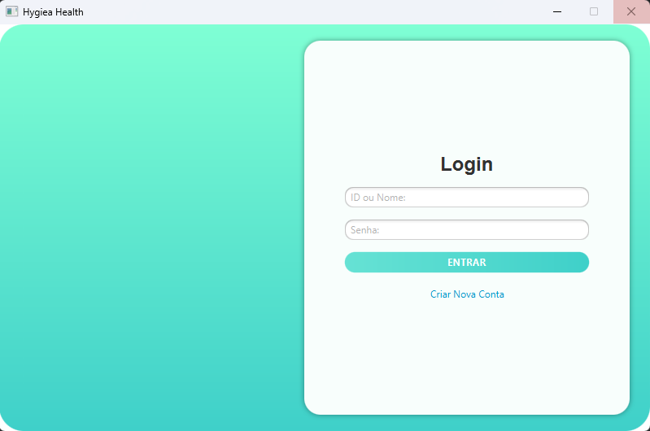 | 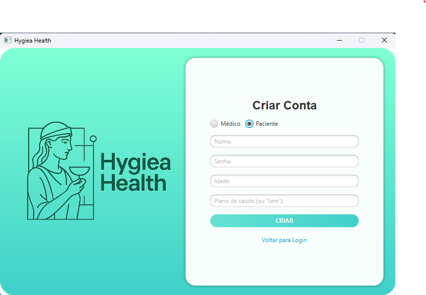 | 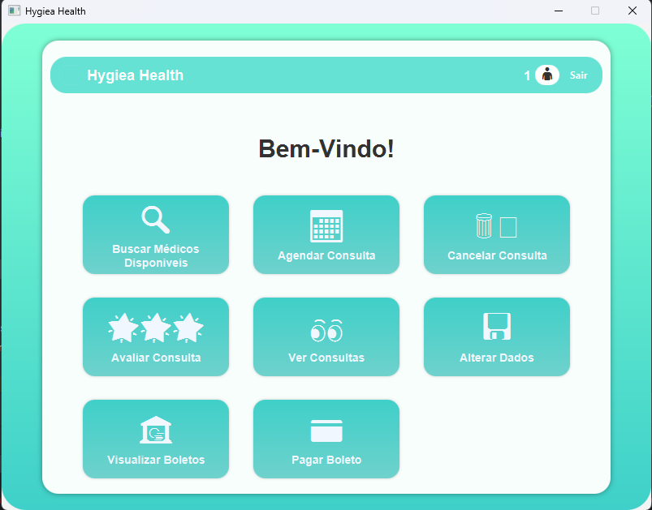 |
| 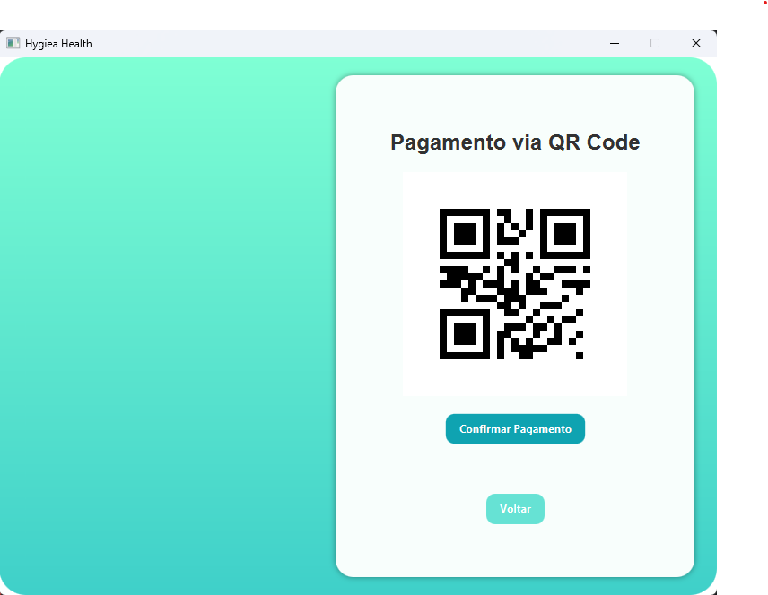 | 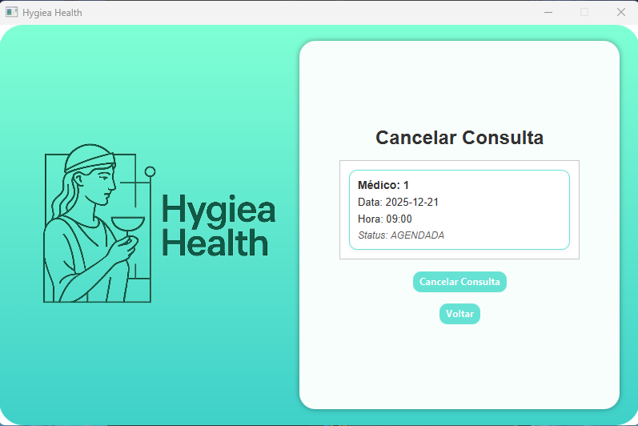 | 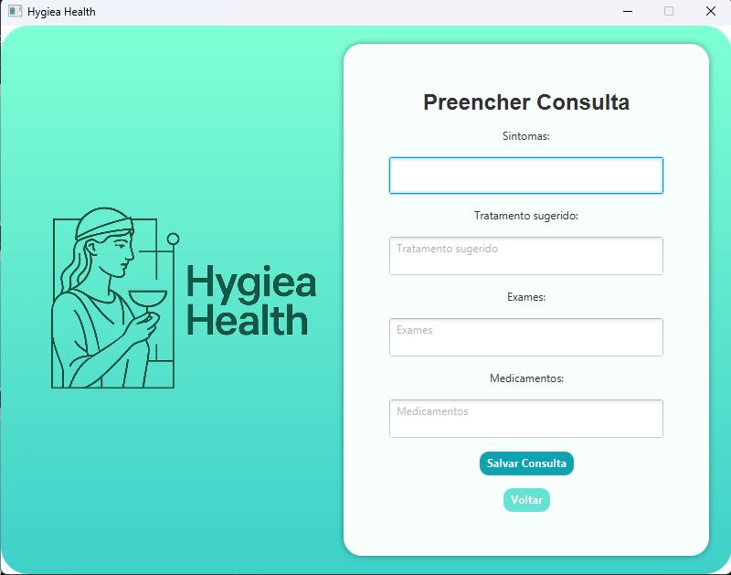 |
| 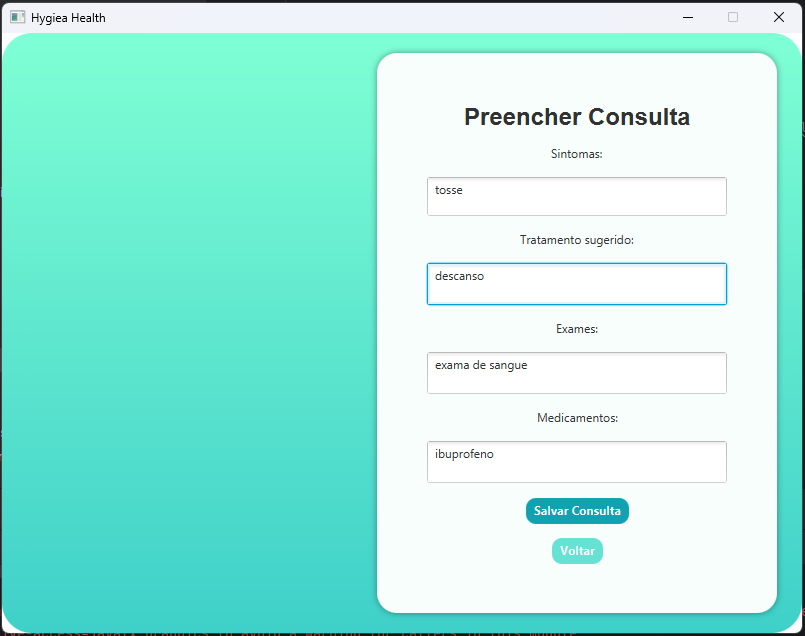 | 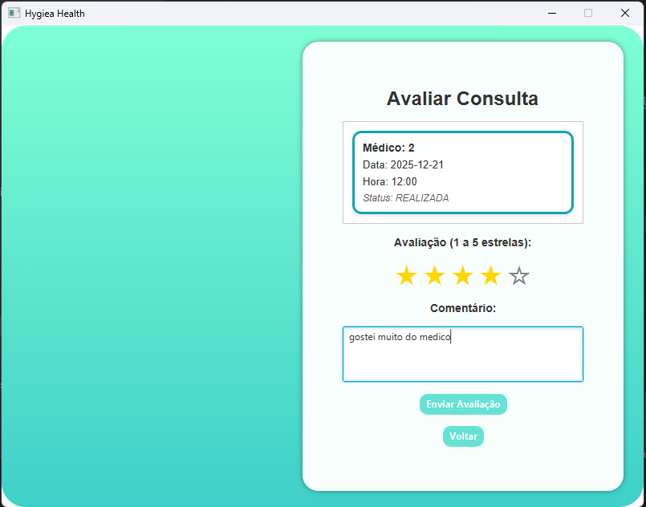 | 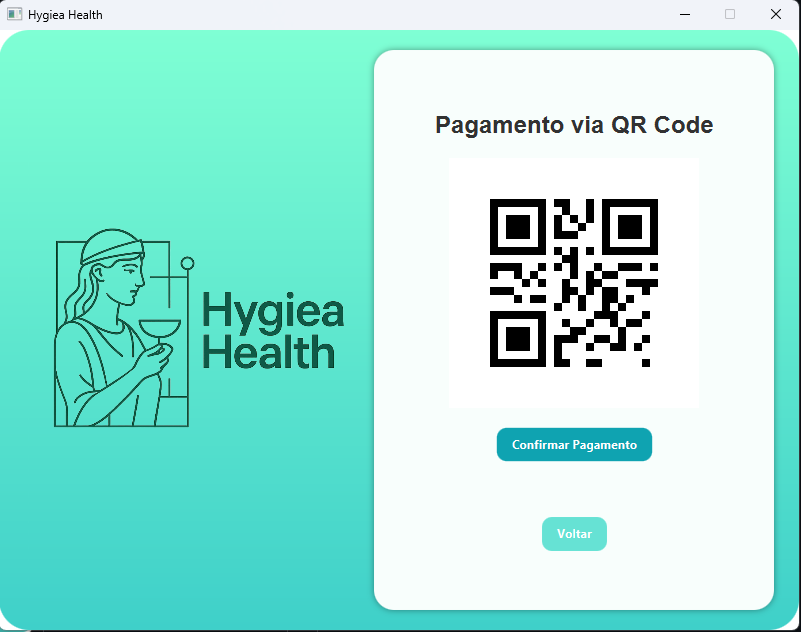 |
| 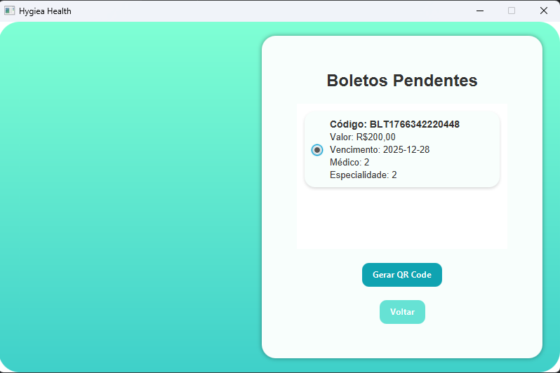 | 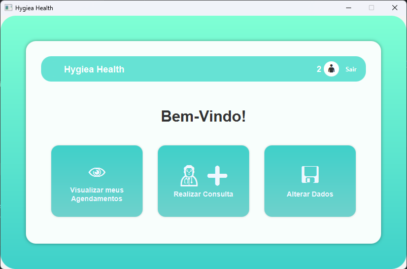 |

---

## 🛠️ Funcionalidades

O sistema possui diferentes níveis de acesso e funcionalidades:

### 👨‍⚕️ Módulo Médico
* Visualização da agenda diária e semanal.
* Acesso ao prontuário eletrônico do paciente.
* Registro de diagnósticos e prescrições.

### 👤 Módulo Paciente
* Cadastro e atualização de dados pessoais.
* Histórico de consultas realizadas.
* Visualização de receitas médicas.

### ⚙️ Módulo Administrativo (Secretaria)
* **CRUD Completo:** Médicos, Pacientes e Especialidades.
* **Agendamento:** Marcação, reagendamento e cancelamento de consultas.
* Gerenciamento de disponibilidade de horários.

---

## 💻 Tecnologias e Ferramentas

* **Linguagem:** Java (OpenJDK 25)
* **Interface Gráfica:** JavaFX
* **IDE:** IntelliJ IDEA
* **Gerenciamento de Dependências:** (Maven ou Gradle - *Escolha um*)
* **Persistência de Dados:** (Ex: Arquivos Binários / SQLite / MySQL - *Edite aqui*)

---

## 📚 Conceitos de POO Aplicados

Durante o desenvolvimento, foram utilizados os seguintes conceitos acadêmicos:

1.  **Herança:** Utilizada para criar hierarquias de usuários (`Pessoa` -> `Medico`, `Paciente`).
2.  **Polimorfismo:** Implementado nas interfaces de repositório e tratamento de diferentes tipos de consulta.
3.  **Encapsulamento:** Proteção dos atributos das classes de domínio (Models) através de métodos Getters e Setters.
4.  **Tratamento de Exceções:** Uso de `try-catch` para garantir que o sistema não feche abruptamente em caso de erros de entrada ou banco de dados.
5.  **Interface Gráfica (MVC):** Separação lógica entre a interface (`.fxml`), o controle (`Controller`) e os dados (`Model`).

---

## 🚀 Como Executar o Projeto

### Pré-requisitos
* Java JDK 17 ou superior (Recomendado JDK 25).
* IntelliJ IDEA (ou outra IDE compatível).

### Passo a Passo
1.  Clone este repositório:
2.  Abra o projeto no IntelliJ IDEA.
3.  selecione o java jdk 24 e isntale a lib do open javafx, junto com as 2 libs javase e core que estao na pasta out.
4.  Localize a classe Main.java dentro do pacote principal.
5.  Execute o método `main`.

---

## 👨‍💻 Autores

* **kaynan santos** 
* **ana beatriz duarte** 

---

*Desenvolvido com ☕ e Java na UECE.*
